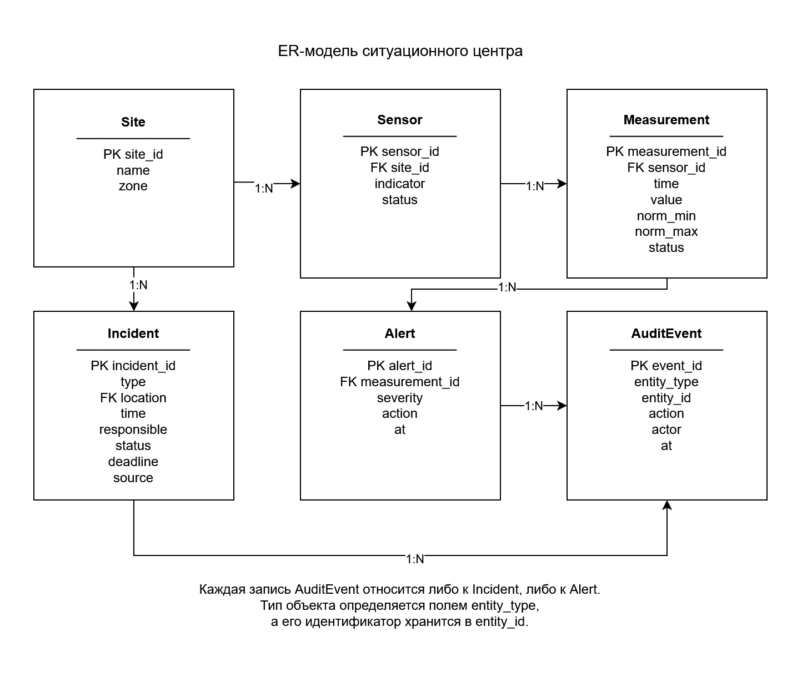
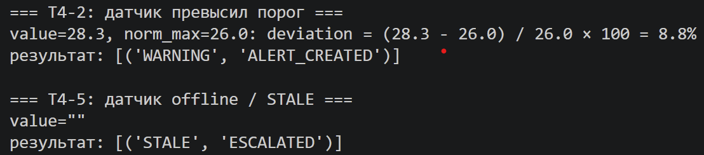

# Приложение — кейс 4

## A. Диаграммы

### A.1. Схема системы

```text
Датчики
   │ показание: участок, показатель, значение, время
   ▼
Приём и проверка
   │ проверенные данные
   ▼
Правила оповещений
   ├── алерт ──► Оповещение ──► Диспетчер
   │
   └── правило A-3 ──► Инцидент ──► Диспетчер
```

Схема описывает проектируемую систему. В прототипе сообщения датчиков воспроизводятся чтением CSV, а оповещения сохраняются на компьютере. Автоинцидент создаётся по A-3, а не при каждом оповещении.

### A.2. ER-модель



### A.3. Жизненный цикл инцидента

```text
NEW ──назначение──► ASSIGNED ──начало работ──► IN_PROGRESS ──завершение──► CLOSED

ASSIGNED ──ложный вызов, resolution_reason=NO_ACTION──► CLOSED
```

- Назначает ответственного диспетчер или руководитель.
- Начинает работу назначенный инженер.
- Закрывает инцидент руководитель.
- NEW → CLOSED напрямую запрещён.
- CLOSED → любой другой статус запрещён: при необходимости создаётся новый инцидент.
- ASSIGNED → CLOSED разрешён только для ложного вызова с причиной NO_ACTION.

### A.4. Схема потоков данных

```text
Показания датчиков
       │
       ▼
Приём → Проверка → Правила
                      ├──► Оповещение
                      └──► Автоинцидент по A-3

Сообщение об инциденте
       │
       ▼
Приём → Проверка → Создание → Назначение → Работа → Закрытие

Создание объектов и изменения статусов
       │
       ▼
Журнал аудита
```

В прототипе показания поступают из `indicators.csv`, исходные инциденты — из `incidents.csv`. Создание инцидента и переходы статусов также проверяются вызовами функций.

Сетевой приём из мобильного приложения не реализован.

## B. Таблицы

### B.1. Правила оповещений A-1…A-5

| ID | Условие | Действие | severity |
|---|---|---|---|
| A-1 | value < norm_min или value > norm_max | Создать алерт | WARNING |
| A-2 | Отклонение больше 10% от нарушенной границы нормы | Эскалировать руководителю | CRITICAL |
| A-3 | Два CRITICAL подряд для одной пары location + indicator в пределах 15 минут | Создать автоинцидент с source=auto | CRITICAL |
| A-4 | Пустое значение или отсутствие показаний более пяти минут | Создать оповещение и эскалировать руководителю | STALE |
| A-5 | Повтор по той же паре location + indicator менее чем через пять минут после создания алерта | Не создавать второй алерт; вернуть DUPLICATE | — |

A-2 уточняет уровень для отклонений из A-1: при отклонении больше 10% используется CRITICAL.

Новое показание учитывается для A-3 до подавления повторного алерта по A-5. Поэтому два CRITICAL за три минуты могут создать автоинцидент, сохранив один алерт.

Если по тому же участку и показателю уже есть открытый инцидент, ещё один автоинцидент не создаётся. Это уточнение команды, реализованное в прототипе.

### B.2. Формула severity

При превышении верхней границы:

```text
deviation_pct = (value − norm_max) / norm_max × 100
```

При значении ниже нижней границы:

```text
deviation_pct = (norm_min − value) / norm_min × 100
```

| Условие | severity |
|---|---|
| 0 < deviation_pct ≤ 5 | WARNING |
| 5 < deviation_pct ≤ 10 | WARNING |
| deviation_pct > 10 | CRITICAL |
| value отсутствует | STALE |
| norm_min ≤ value ≤ norm_max | NORMAL |

Отсутствие новых показаний более пяти минут определяется правилом A-4.

**Пример расчёта:**

```text
value = 28.3
norm_max = 26.0

deviation_pct = (28.3 − 26.0) / 26.0 × 100 ≈ 8.8%

severity = WARNING
```

Границы нормы включены. Порог 5% не меняет уровень: обе ветви до 10% включительно дают WARNING.

### B.3. SLA

| severity | Реакция | Закрытие | Просрочка |
|---|---|---|---|
| CRITICAL | 15 минут | 1 час | Эскалация руководителю |
| WARNING | 1 час | 4 часа | Напоминание диспетчеру |
| STALE | 30 минут | 1 час | Эскалация руководителю |

В прототипе реакцией считается назначение ответственного инженера. Для нового инцидента сроки отсчитываются от создания; время закрытия не прибавляется ко времени реакции.

### B.4. Роли — RBAC

| Действие | Диспетчер | Руководитель | Инженер | Администратор |
|---|---|---|---|---|
| Создать инцидент | Да | Да | Да | Нет |
| Назначить ответственного | Да | Да | Нет | Нет |
| Сменить статус на IN_PROGRESS | Нет | Нет | Только для назначенного ему инцидента | Нет |
| Закрыть инцидент | Нет | Да | Нет | Нет |
| Переоткрыть CLOSED | Нет | Только через создание нового инцидента | Нет | Нет |
| Изменить справочник участков | Нет | Нет | Нет | Да |
| Просмотреть аудит | Да | Да | Нет | Нет |

Создание новой записи не переоткрывает старую.

Права дополнительно ограничиваются разрешёнными зонами. В консольной версии профиль задаёт доверенный оператор; проверка личности пользователя не реализована.

### B.5. Тесты T4-1…T4-5

Проверки выполнены файлом `test_prototype.py` на отдельных тестовых данных без изменения исходных CSV.

| Тест | Вход | Ожидание | Факт | Пройден |
|---|---|---|---|---|
| T4-1 | Создать инцидент на site_01 с ответственным e_101, затем назначить диспетчером | NEW → ASSIGNED; ответственный сохранён; две записи аудита | Создан inc_001; после назначения статус ASSIGNED, responsible=e_101; в аудите created и assigned для объекта incident | Да |
| T4-2 | Температура 28.3 при верхней границе 26.0 | Отклонение около 8.8%; WARNING; запись в alerts_out.csv | Рассчитан WARNING, запись сохранена | Да |
| T4-3 | Пустой location или site_99 | Отказ по UNKNOWN_LOCATION; инцидент не создан | Возвращена VALIDATION_ERROR с details.field=location и details.code=UNKNOWN_LOCATION; инцидент не создан | Да |
| T4-4 | Два события с одинаковыми location + indicator за три минуты | Второе событие — DUPLICATE; один алерт | Повтор подавлен; второй алерт не создан | Да |
| T4-5 | Пустое значение показания | STALE и эскалация; не CRITICAL | Сохранён STALE с action=ESCALATED | Да |

В T4-1 названия действий исходного образца `incident_created` и `incident_assigned` представлены отдельными полями: `entity_type=incident`, `action=created` или `assigned`.

В T4-3 проверяется возвращаемая ошибка функции. HTTP-сервера нет; получение HTTP-статуса 422 не заявляется.


## B.6. Требования

### Функциональные требования

| ID | Требование | Приоритет | Тест |
|---|---|---|---|
| FR-1 | Принять показатель от датчика (time, location, indicator, value) | Must | T4-2 |
| FR-2 | Принимать инцидент из мобильного приложения | Must | T4-1 |
| FR-3 | Рассчитывать severity по формуле процентного отклонения от границ нормы | Must | T4-2 |
| FR-4 | Создавать оповещения WARNING, CRITICAL и STALE | Must | T4-2, T4-5 |
| FR-5 | Эскалировать оповещения CRITICAL и STALE руководителю | Must | T4-5 |
| FR-6 | Не создавать повторный алерт для одинаковых location + indicator в окне 5 минут | Must | T4-4 |
| FR-7 | Поддерживать жизненный цикл NEW → ASSIGNED → IN_PROGRESS → CLOSED и закрытие ложного вызова из ASSIGNED с NO_ACTION | Must | T4-1 |
| FR-8 | Проверять роль пользователя и разрешённую зону при смене статуса; начало работы разрешать только назначенному инженеру | Must | T4-1 |
| FR-9 | Записывать создание инцидента и каждый переход статуса в аудит | Must | T4-1 |
| FR-10 | Отклонять события с пустым или неизвестным location | Must | T4-3 |

### Нефункциональные требования

| ID | Требование | Измеримость |
|---|---|---|
| NFR-1 | Алерт CRITICAL доставляется диспетчеру не позднее 1 минуты | секунды |
| NFR-2 | Не создавать повторный алерт для одинаковых location + indicator менее чем через 5 минут после предыдущего | минуты |
| NFR-3 | Определять STALE при отсутствии показаний более 5 минут | минуты |
| NFR-4 | Ограничивать доступ к данным по роли и разрешённым зонам zone_A, zone_B, zone_C | роли × зоны |
| NFR-5 | Вести аудит только с добавлением новых записей; хранить не менее 90 дней | дни |

Ограничения: реальных датчиков нет (используются синтетические CSV), мобильное приложение не разрабатывается (описан контракт приёма инцидента), время на кейс ограничено.

## B.7. Словарь данных (Data Dictionary)

### Site — участок

| Поле | Тип | Обяз. | Правило | Пример |
|---|---|---|---|---|
| site_id | string, PK | да | шаблон `site_NN`, существует в справочнике | site_01 |
| name | string | да | непустая строка | Птичник №1 |
| zone | string | да | zone_A, zone_B или zone_C | zone_A |

### Sensor — датчик

| Поле | Тип | Обяз. | Правило | Пример |
|---|---|---|---|---|
| sensor_id | string, PK | да | уникальный | — |
| site_id | string, FK → Site.site_id | да | участок должен существовать | site_02 |
| indicator | enum | да | temperature, humidity, ventilation | temperature |
| status | enum | да | ACTIVE, OFFLINE | ACTIVE |

### Measurement — показание

| Поле | Тип | Обяз. | Правило | Пример |
|---|---|---|---|---|
| measurement_id | string, PK | да | уникальный | msr_000001 |
| sensor_id | string, FK → Sensor.sensor_id | да | датчик должен существовать | — |
| time | string, ISO 8601 | да | дата и время, время не убывает в потоке | 2025-11-01T08:00:00Z |
| value | decimal, допускается null | нет | пустое значение означает STALE | 28.3 |
| norm_min | decimal | да | нижняя граница нормы | 20 |
| norm_max | decimal | да | верхняя граница нормы | 26 |
| status | enum | да | NORMAL, WARNING, CRITICAL, STALE | WARNING |

### Incident — инцидент

| Поле | Тип | Обяз. | Правило | Пример |
|---|---|---|---|---|
| incident_id | string, PK | да | шаблон `inc_NNN` | inc_001 |
| type | enum | да | temperature, ventilation, humidity, equipment, other | temperature |
| location | string, FK → Site.site_id | да | участок должен существовать, иначе UNKNOWN_LOCATION | site_01 |
| time | string, ISO 8601 | да | время создания | 2025-11-01T08:00:00Z |
| responsible | string, допускается null | нет | обязателен для ASSIGNED, IN_PROGRESS, CLOSED | e_101 |
| status | enum | да | NEW, ASSIGNED, IN_PROGRESS, CLOSED; переходы по жизненному циклу | NEW |
| deadline | string, ISO 8601 | да | срок закрытия по SLA, вычисляется обработчиком | — |
| source | enum | да | mobile, sensor, auto | auto |

В схеме события `IncidentEvent` (`10_API.yaml`) дополнительно предусмотрено необязательное поле `severity` (WARNING, CRITICAL, STALE) для расчёта SLA. В запросе перехода `TransitionRequest` используется поле `resolution_reason`; для закрытия из ASSIGNED оно обязательно со значением NO_ACTION.

### Alert — оповещение

| Поле | Тип | Обяз. | Правило | Пример |
|---|---|---|---|---|
| alert_id | string, PK | да | шаблон `alrt_NNNN` | alrt_0001 |
| measurement_id | string, FK → Measurement.measurement_id | да | показание должно существовать | msr_000001 |
| severity | enum | да | WARNING, CRITICAL, STALE | WARNING |
| action | enum | да | ALERT_CREATED, ESCALATED, DUPLICATE | ALERT_CREATED |
| at | string, ISO 8601 | да | время создания | 2025-11-01T08:00:00Z |

### AuditEvent — запись аудита

| Поле | Тип | Обяз. | Правило | Пример |
|---|---|---|---|---|
| event_id | string, PK | да | уникальный | — |
| entity_type | enum | да | incident или alert (определяет, на что указывает entity_id) | incident |
| entity_id | string | да | идентификатор Incident или Alert | inc_001 |
| action | enum | да | created, assigned, status_changed, closed | assigned |
| actor | string | да | роль или идентификатор пользователя | dispatcher_1 |
| at | string, ISO 8601 | да | время действия; запись не изменяется и не удаляется | 2025-11-01T08:05:00Z |

### TelemetryEvent — событие датчика (вход)

| Поле | Тип | Обяз. | Правило | Пример |
|---|---|---|---|---|
| event_id | string | да | шаблон `evt_` + 6–32 символа | evt_ab12cd |
| time | string, date-time | да | ISO 8601 | 2025-11-01T08:00:00Z |
| location | string | да | шаблон `site_NN`; наличие в справочнике проверяется отдельно | site_01 |
| indicator | enum | да | temperature, humidity, ventilation | temperature |
| value | number | да | число; пустая строка CSV — условность эмулятора | 28.3 |
| signature | string | нет в схеме | HMAC-SHA256 подпись; приёмник отклоняет событие с неверной подписью | — |

Нормы norm_min и norm_max в событие не входят: они берутся из каталога датчиков.


В `10_API.yaml` перечень кодов шире: добавлены UNAUTHORIZED, INVALID_RESPONSIBLE, NO_ACTION_REQUIRED, INVALID_SITE_ID, INVALID_NAME, DUPLICATE_EVENT.


## B.8. Угрозы информационной безопасности и меры

| Угроза | Мера | Остаточный риск |
|---|---|---|
| Подмена показания датчика | HMAC-подпись внешнего события | Ключ должен оставаться секретным; HMAC не шифрует данные |
| Выполнение действия чужой ролью или в чужой зоне | Проверка роли, зоны и назначения при смене статуса | В консольной версии профиль задаёт оператор; личность пользователя не проверяется |
| Датчик замолчал | Статус STALE и эскалация руководителю | Тишина определяется по времени в CSV; непрерывной службы нет |
| Потеря или правка истории действий | Журнал аудита только с добавлением записей | Нужны права ОС и резервные копии; 90 дней хранения в прототипе не доказываются |
| Повторная доставка события | `event_id` и правило A-5 | Память повторов действует в пределах одного запуска |
| Расхождение исходного status с расчётом | Статус пересчитывается по формуле | В исходном CSV шесть значений 26 °C помечены WARNING, хотя это граница нормы; программа даёт NORMAL |

Для реального внедрения нужны: аутентификация пользователей, постоянная память повторов, сетевой контур и защищённое хранилище аудита.

## C. Журнал промптов

# Журнал промптов — кейс 4


ИИ-ассистент использовался как помощник: каждый результат проверялся запуском кода, сверкой с файлами проекта или расчётом, а решения о правках принимала команда.


| Дата | Цель | Промпт (сжато) | Результат | Проверка | Использовано |
| --- | --- | --- | --- | --- | --- |
| 2026-11-04 | Дописать прототип | Реализовать необходимые функции простыми конструкциями | Код прототипа и последующие исправления | Сверка с правилами, запуск тестов | Да, переработано |
| 2026-11-04 | Подготовить тесты | Проверить пять сценариев понятным кодом | Автоматические тесты | Запуск и проверка результатов | Да |
| 2026-11-05 | Заполнить схемы событий (10_API.yaml) | Заполнить схемы IncidentEvent, AlertEvent, TransitionRequest и Error по подсказкам шаблона | Схемы с шаблонами идентификаторов, перечислениями значений, условными правилами (для статусов ASSIGNED, IN_PROGRESS, CLOSED обязателен `responsible`; для перехода в ASSIGNED обязателен `responsible`), примеры корректных и некорректных событий, пояснения о том, что JSON Schema не проверяет | Сверка полей и перечислений с 08_ER.md и прототипом | Да, переработано |
| 2026-11-07 | Проверить правила и прототип целиком | «Отправил zip с заданием. Я сделал правила и прототип: проверь, всё ли нормально, скажи, что исправить, и объясни» | Найдены ошибки в прототипе: ветка «>300 сек» делала любое показание STALE, `critical_streak` не определена, опечатка DUBLICATE, строки CSV не по времени, NameError в `transition_incident`, файл результата дописывался при каждом запуске. Замечания к правилам: нет пустой строки перед «Подсказки», ASSIGNED→CLOSED в обеих таблицах, 6 строк с value=26.0 помечены WARNING | Прогон прототипа на indicators.csv до и после: было 73 STALE и ни одного WARNING/CRITICAL, стало 14 WARNING, 8 CRITICAL, 2 STALE | Да, исправления внесены в код |
| 2026-11-07 | Получить рабочие функции | «Что надо сделать, чтобы прототип заработал? Напиши функции и опиши, что ты сделал» | Переписаны `check_indicator`, `transition_incident`, `main`, добавлены `audit_log`, `create_incident`, разбор каждой правки | Сценарии T4-1…T4-5 на отдельных данных: 28.3 даёт WARNING (8.8%), второе событие через 3 минуты даёт DUPLICATE, пустое значение даёт STALE + ESCALATED | Да, переработано под свой стиль |
| 2026-11-07 | Принять решение по A-4 | «В условии: больше 5 минут — STALE, значит выполнять по правилу, и пусть это будет внутри `check_indicator`» | Правило встроено в `check_indicator`; функция возвращает список (STALE, потом оценка самого показания), чтобы не терять CRITICAL и работало A-3 | Сценарий 10:00 / 10:03 / 10:08: DUPLICATE, затем STALE + автоинцидент; прогон на данных | Да |
| 2026-11-07 | Довести A-4 до конца | «Есть ли ещё что-то по A-4? Если данных нет больше 5 минут, это STALE, делай всё по правилу» | Добавлены `find_silent_sensors` и проверка в конце файла для датчиков, замолчавших после последнего показания | Тест из трёх строк: замолчавший датчик получил STALE, свежий нет, пустое значение не продублировано; на данных +13 STALE | Да |
| 2026-11-07 | Разобрать внешнюю проверку | «Вот ошибки по этому коду (скриншоты): исправь, покажи таблицей, что значит» | Каждое замечание проверено на коде. Подтверждены: WARNING→CRITICAL терялся как «дубль», NORMAL между двумя CRITICAL не сбрасывал серию, дублировались автоинциденты, роль «anything» создавала инцидент. Внесено: дедупликация по severity, один открытый автоинцидент, STALE по ходу потока, белый список ролей, сохранение аудита и автоинцидентов, единый формат ошибок, контроль SLA. HMAC и зоны осознанно не реализованы (обосновано) | 7 сценариев (08:00/08:01, CRITICAL-NORMAL-CRITICAL, три CRITICAL подряд, дубль через 3 минуты, роль «anything» и др.); прогон на данных: 121 алерт | Да |
| 2026-11-07 | Понять код для защиты | «Зачем `timedelta(0)` в A-5?», «объясни `audit_log` и `create_incident` построчно», «что значит `**data` и зачем `None` в `return`», «объясни `main` построчно» | Построчные объяснения. Вопрос «а где вызов `audit_log`?» выявил, что функции не вызывались из `main` | Сверено с кодом; вопросы автора привели к исправлению (мёртвый код) | Для понимания, в проект не вставлялось |
| 2026-11-08 | Проверить согласованность | Сверить готовые файлы проекта | Найдены расхождения в описаниях и реализации | Сопоставление файлов с кодом | Да |
| 2026-11-08 | Устранить расхождения | Исправить найденные несогласованности | Уточнены правила, результаты тестов, ER-модель и требования | Повторный запуск пяти тестов | Да |
| 2026-11-08 | Привести схемы событий в соответствие с кодом (10_API.yaml) | Убрать из описания схем проверку личности по токену, которой в консольной версии нет | В описании `actor` и в пояснениях указано: роль, идентификатор и зоны задаёт доверенный оператор, личность не проверяется; `source` определяет обработчик (mobile — ручное создание, auto — автоинцидент) | Сравнение старой и новой версий файла, сверка с прототипом и 11_ИБ.md | Да |


## D. Матрица вклада

| Участник | Файлы / задачи | Часы | Подпись |
|---|---|---|---|
| Ичмелян Арман Альбертович | Требования и схемы: 02_правила.md, 08_ER.md, ER-диаграмма, 09_требования.md | [23] | Ичмелян А. А. |
| Аюрзанаев Алдар Зориктуевич | Код и тесты: 04_прототип.py, test_prototype.py | [17] | Аюрзанаев А. З. |
| Савенко Александр Романович | Информационная безопасность и схемы событий: 10_API.yaml, 11_ИБ.md | [11] | Савенко А. Р. |

## E. Артефакты

- **Ссылка на фактическую рабочую ветку:** https://github.com/armanichmelyan/case-4-situation-center/tree/team_5_case_4  

- **Скриншот последнего коммита:**  
  [Вставить скриншот окончательного коммита после добавления материалов.]

- **Скриншот вывода прототипа на T4-2 и T4-5:**  


- **MD5 файла `01_данные/indicators.csv`, проверенная 08.11.2026:**

```text
74BEF253784C98E2AFBBB9A9FE910226
```


## F. Чек-лист приложения

- [x] Схема системы — A.1.
- [x] ER-модель — A.2.
- [x] Жизненный цикл — A.3.
- [x] Схема потоков — A.4.
- [x] Правила A-1…A-5 — B.1.
- [x] Формула severity и пример — B.2.
- [x] SLA — B.3.
- [x] RBAC — B.4.
- [x] Тесты с фактом — B.5.
- [x] Журнал промптов проверен, даты уточнены — C.
- [x] В матрице вклада указаны часы и поставлены подписи — D.
- [x] Ветка Git и скриншоты подготовлены — E.
- [x] Приложение экспортировано в PDF до защиты.